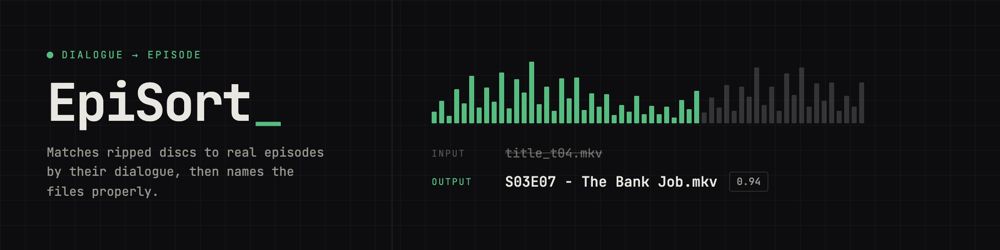

# EpiSort



Matches ripped discs to real episodes by their dialogue, then names the files properly.

Scans a directory of MKV files ripped from BluRay discs, extracts dialogue via embedded subtitles or local Whisper transcription, compares against reference subtitles from OpenSubtitles, and renames each file to standard `S01E01 - Title.mkv` format when confidence meets the threshold.

Files below the threshold get a second chance: once a season's files have all been scored, each one is mapped onto its highest-scoring episode that no other file has claimed and reported as `filled` (not `renamed`) in the summary. This rescues files whose text clearly points at one episode but whose confidence lands just under the threshold because a runner-up is close. An episode only qualifies if its raw text score reaches `--fill-min-score` (default 0.40; `0` takes the best unclaimed episode regardless), and each file stays within its own disc's episode range. Use `--no-fill-unmatched` to turn this off.

Whatever still doesn't qualify is renamed with an `UNMATCHED_` prefix so it is visible for manual review but does not get silently lost.

## Usage

```bash
python identifier.py "/path/to/Show/Season 1"
python identifier.py /path/to/Show --season 1 --dry-run
python identifier.py "/path/to/Show/Season 2" --threshold 0.85 --whisper-model small
```

`--json FILE` also writes every file's result as JSON (`-` for stdout; the log then goes to stderr). `--mlx-whisper` transcribes on the Apple Silicon GPU with mlx-whisper instead of the remote server.

## Setup

Copy `.secrets.example` to `tv.secrets` and fill in your OpenSubtitles credentials (and optionally an Anthropic key for `--ai-fallback`). See `.secrets.example` for the full key list.

```bash
pip install -r requirements.txt
```

Or install it as a package (adds the `episort` command). Whisper and OCR are extras: `whisper` (local openai-whisper), `mlx` (mlx-whisper, Apple Silicon) and `ocr` (Pillow, plus the tesseract binary).

```bash
pip install ".[ocr]"
```

## Library use

`identify()` runs the same matching as the CLI but never renames, never prompts, and takes its credentials and settings as arguments. Rename after you've reviewed the matches:

```python
from episort import IdentifyConfig, identify, apply_renames

config = IdentifyConfig.from_env()          # OPENSUBTITLES_*, TMDB_API_KEY, ANTHROPIC_API_KEY
matches = identify("/rips/White Collar/Season 1", tvmaze_id=323, season=1, config=config)
for m in matches:
    print(m.path.name, m.key, m.method, f"{m.confidence:.0%}", m.evidence["top_scores"][:2])
apply_renames([m for m in matches if m.method == "direct"])   # S01E01.mkv, ...
```

Each `EpisodeMatch` has the path, season, episode, title, confidence, a method (`direct`, `ai_fallback`, `filled` or `unmatched`) and the evidence behind it (top scores, where the text came from, the episode window, why a file wasn't matched). `episode_range` bounds the candidates, for example from a disc's title map.

## Testing

```bash
pip install -r requirements-dev.txt
pytest
```
